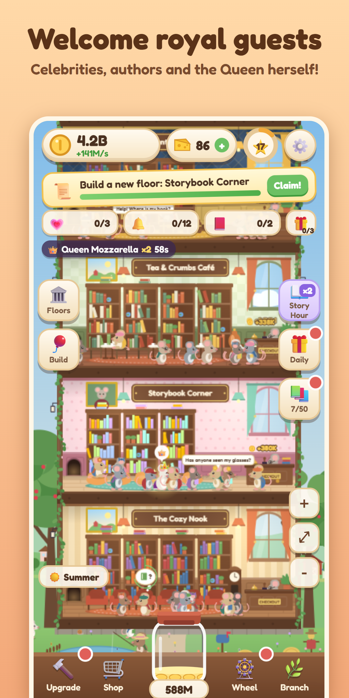
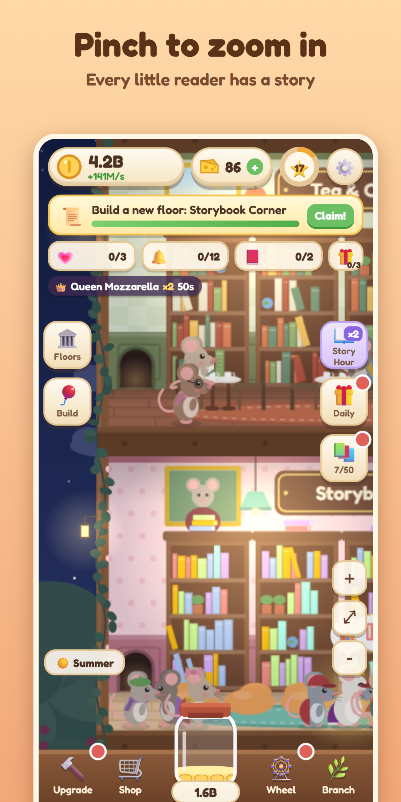
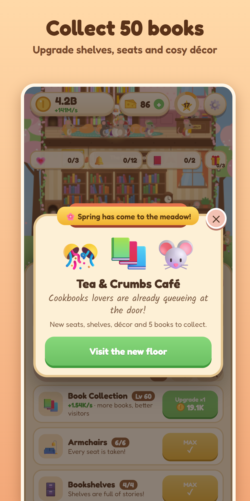

# 🐭📚 Whiskerwood Library

A cozy idle "expansion" game for mobile. You run a library for mice: every little reader pays at the checkout, the coins pile up in the **coin jar** at the bottom-centre of the screen, and you tap it to collect. Spend the coins on armchairs, bookshelves, book collections and new floors, so more mice come in and the coins arrive faster. Along the way you'll get celebrity mice, royal visits and authors holding book signings.

The art is flat vector, drawn in code (2D with a slight 3D cross-section look). The Ghibli-style waltz soundtrack is original and plays live through Web Audio. The sound effects are Kenney's CC0 packs. Ads use AdMob (native) or Google H5 Games Ads (web).

| Story | Royal visit | Shoo the cat! | Pinch to zoom |
|---|---|---|---|
|  |  |  |  |
| **Seasons & weather** | **Book Fair** | **Upgrades & books** | |
|  |  |  | |

🎵 Soundtrack previews: [`docs/soundtrack-day-preview.mp3`](docs/soundtrack-day-preview.mp3) · [`docs/soundtrack-night-preview.mp3`](docs/soundtrack-night-preview.mp3)

---

## Quick start

```bash
npm install
npm run dev          # http://localhost:5173 (also prints a LAN URL to open on your phone)
npm run build        # production build in dist/
```

In the browser, ads show as a clearly labelled **test ad** (4 s countdown), so you can try every ad placement without an ad account.

Debug in the browser console:
- `WWL.game.s.coins += 1e9` adds coins.
- `WWL.world.spawnSpecial()` brings a special guest.
- `WWL.world.events.start('cat' | 'worms' | 'lost' | 'critic' | 'fair' | 'thief')` starts an event.
- `WWL.world.seasonOverride = 3` switches to winter.
- `WWL.world.ambient.weather.left = 0` changes the weather now.
- `WWL.world.debugBranch(3)` jumps to a location (0 Meadow … 5 Nimbus Isle).
- `WWL.world.debugFestival('ramadan')` previews a festival (`null` turns it off).
- `WWL.world.spawnRegular('squeaky')` brings a regular; `WWL.world.events.startSpoiler(1)` / `startDebate(0)` start the new events.

---

## The game

### Core loop
1. **Visitor mice** pop out of the mousehole, browse a shelf, read in an armchair, then **pay at the checkout desk**.
2. Their coins drop into the **coin jar** (bottom centre). Tap it to collect. The jar has a capacity (10 min of income, upgradable), so check back often.
3. Spend the coins on each floor's upgrades:
   | Track | Effect | Notes |
   |---|---|---|
   | 📚 Book Collection (Lv 1–1000) | + income per level | **×2 income milestones** at Lv 10, 25, 50, 100, 150… The first five milestones each deliver one of the floor's album books |
   | 🪑 Seats (1–6) | more mice read at once | each seat adds a visible chair or beanbag |
   | 🗄️ Bookshelves (1–4) | attracts more visitors | the shelves visibly fill with books as the level rises, and book piles appear on top |
   | 👓 Librarian (1–20) | faster checkout | |
   | ✨ Décor ×5 | +20–40% each | rug, lamps (glow at night), fern, painting and a unique centerpiece |
4. **Build new floors.** There are 10 themed floors (Cozy Nook → Storybook Corner → Tea & Crumbs Café → Adventure Map Room → Mystery Attic → Poetry Greenhouse → Stargazer Observatory → Royal Archive → Moonlit Music Hall → Grand Atrium). Each has its own wallpaper, seats, centerpiece, genre and 5 collectible books. Construction timers show builder mice at work.
5. **The World Map (prestige):** once the Grand Atrium is built, move the library to the next location and earn **Golden Quills** (+10% income each, forever). Floors and coins start fresh, but everything else comes with you (see *Kept forever* below), and the Map spells out what moves, what's new and what you'll earn before you commit.

### Six locations ([src/data/locations.js](src/data/locations.js))
Each move is a real upgrade, not a repaint. Every location has its own tower shell, roof, windows, walls, floors, shelves, lamps, desk, wall fixtures, sky, far scenery and grounds. It also brings a host character, a shop with its own keeper, a signature mechanic, three souvenirs and a Passport perk.

| Location | Library | Income | Mechanic | Passport perk (earned on leaving) |
|---|---|---|---|---|
| Meadow Burrow | Whiskerwood Library | ×1 | Pond fishing | **Moving Van**: every new location opens with 3 floors built |
| Lighthouse Cove | The Lighthouse Lending Library | ×1.5 | Messages in bottles wash up (letters + coins) | **Sea Breeze**: offline earnings 80% instead of 60% |
| Glimmerdeep Caverns | The Glimmerdeep Undercroft | ×2.5 | Glowcap harvest (tap glowing mushrooms) | **Glowcap Jar**: the coin jar holds 50% more |
| Gearhaven | The Clockwork Athenaeum | ×4 | Book-tube post capsules | **Swift Scaffolds**: floors build twice as fast |
| Moonlit Castle | The Moonlit Stacks | ×7 | Sir Reginald the bookwyrm, perched on the tower | **Royal Favour**: more special guests, longer decrees |
| Nimbus Isle | The Nimbus Sky Library | ×12 | The cloud whale drifts past (tap for a gift) | **Tailwind**: +25% Golden Quills on every move |

After Nimbus Isle the road loops back to the meadow at ×10 income (Meadow Burrow II, …).

### Kept forever
Moving never feels like losing: every one of these carries a permanent income bonus that stacks with quills.
- **Furniture** ([src/data/furniture.js](src/data/furniture.js)): 97 pieces in 11 slots (rugs, lamps, plants, wall art, shelves, desks, seats, centrepieces, librarian hats, garden pieces, curios). Common/Rare/Epic/Legendary give +3/6/12/25% income. Place them per floor from the floor sheet's **Style** tab; they follow you to every location.
- **Souvenirs:** three per location, found through that location's mechanic (+5% each).
- **Trophies:** build all 10 floors in a location (+15% each).
- **Passport stamps:** the perks in the table above.
- **Regulars' stories** and **festival books** (below).
- The **Collection** screen shows all of it, plus the running total of your permanent bonus.

### Regulars ([src/data/regulars.js](src/data/regulars.js))
Seven recurring characters with name tags (Barnaby Bluffington, Squeaky Spoilsworth, Doris Dogear, Filmore Reel, Professor Footnote, Granny Crumbcake and Tomasina Tome) drop by every few minutes. Tap them to play the next of four short scenes. Finishing a story gives their personal gift (a furniture piece) and +5% income. They follow you to every location.

### Festivals ([src/data/festivals.js](src/data/festivals.js))
Real-calendar festivals transform the world: Ramadan Nights, Eid, the Winter Festival (Christmas), New Year Lights, Spooky Stories Week (Halloween), Book Lovers' Day (Valentine's), Book Week, the Library Birthday, the Summer Reading Festival and the Harvest Reading Festival. Ramadan and both Eids use a lookup table (2025–2031).
- **World:** sky tint and evening light, rooftop lights and emblems, window decor, garlands and hanging items in every room, a festival garden piece, particles, and a music flavour (bells, chimes or a spooky layer). Ramadan is deliberately gentle: lanterns, a crescent moon and warm evening light.
- **Tokens:** glowing festival tokens appear on floors; tap them to collect.
- **Festival board:** a daily gift (📺 ×2), five festival quests, three limited festival books (+3% income each, forever) and two exclusive furniture pieces, all bought with tokens.
- Seasonal festivals hold the in-game season to match, and **NPC dialogue** changes for the occasion. Festivals can be switched off in Settings.

### Engagement systems
- **Special guests**, about every 1–2 minutes, glowing gold with a "Visit" banner. Tap them before they leave:
  - ⭐ Celebrity mice: coin bonus, and ×2 income on that floor while present
  - ✍️ Authors: a book signing, a free book card, and ×3 on that floor
  - 👑 Royals with guards: a Royal Decree giving ×3 income
- **Pigeon Post:** a pigeon carrying a parcel flies past; tap it.
- **Fishing mouse:** tap when the float bobs to catch a fish (coins).
- **Desk bell:** tap the checkout desk to ring it for instant coins (active play).
- **Pet a mouse:** hearts, a squeak and a few coins.
- **Quests:** 15 hand-written onboarding quests with a pointing-hand tutorial, then endless generated quests that always pick a goal reachable in minutes.
- **Reputation level:** every upgrade gives XP, and each level gives golden cheese and +2% income.
- **Book album:** 50 parody books (Common → Legendary). Each gives +10% on its floor, and a complete set gives ×2.
- **Daily gifts:** a 7-day streak that resets if you miss a day. **Lucky wheel:** one free spin every 6 hours.
- **Offline earnings** when you come back. **Story Hour:** ×2 income, stackable up to 4 hours.
- **Juice:** coins fly into the counter, purchase sounds climb in pitch when chained, milestone confetti, haptics, a hold-to-buy button, and a coin pile in the underground vault that grows with your wealth.
- **Day/night cycle** (12 minutes): lamps glow, fireflies, stars and moon, and a gentler nocturne arrangement of the music at night.

### Twists & surprise events ([src/world/events.js](src/world/events.js))
| Event | What happens | How to win |
|---|---|---|
| 🐱 **Baroness Clawdia** | A big cat peeks through a floor's window; readers freeze and the floor earns nothing | Tap her 4–6 times until she flees (coins + cheese) |
| 🐛 **Bookworms** | Worms nibble a floor's shelves (−40% income) | Squish them all (coins each + bonus cheese) |
| 📕 **Lost book** | A glowing book is hidden somewhere in the tower | Scroll and zoom to find it (album book + cheese) |
| 🦹 **Sneaky Rattigan** | A masked rat runs along the bottom bar toward your coin jar | Catch him for a bonus; if he gets there, he steals 20% of the jar |
| 📝 **Monsieur Fromage** | A critic reviews a floor from 1 to 5 stars and says what's missing | 4–5★ gives ×2 income for 5 min (📺 cheese platter adds +1★) |
| 🎪 **Book Fair** | Bunting on the roof, confetti, all income ×2 and extra visitors | 📺 extend by 3 min |
| ❓ **Book requests** | A reader shows a thought bubble with the book they want | Tap within 11 s for a tip and hearts |
| 🌧️ **Weather** | Rainy days (×1.5) and snow days (×1.3) bring more readers, and a rainbow follows the rain | |
| 📣 **Spoiler alert** | Squeaky Spoilsworth is about to shout a book's ending | Tap to shush them in time, or the floor earns ×0.5 for a while (📺 cookie party undoes it) |
| 💬 **Book-club debate** | A floor argues "book or movie?", "dog-earing pages: crime or comfort?"… | Pick a side for a reward and a funny outcome |

### Seasons & life ([src/world/ambient.js](src/world/ambient.js))
- **Seasons** change every 24 minutes: spring blossom petals and tulips, summer sunflowers and butterflies, autumn leaves and pumpkins, winter snow with a frozen pond, a skating mouse, a snowman, and snow and icicles on the roof.
- **Around the library:** passers-by walk to the door (with umbrellas in the rain), a postmouse cycles past, frogs hop between lily pads, ducks swim, a snail crawls by, and two big trees change with the seasons.
- **Sky:** flocks of birds, shooting stars at night (tap one for a wish, +3 cheese) and hot-air balloons (tap for a gift).
- **Background:** a village with glowing windows and chimney smoke, sheep on the hills, and ivy and lanterns growing up the library as it rises.

### A world that talks back
- **Skits** ([src/data/dialogue.js](src/data/dialogue.js)): two-to-four-line conversations and arguments between readers and the librarian, location-specific skits, and occasional fourth-wall jokes.
- **Reactions:** readers comment on what you do, such as upgrades, new furniture, a milestone, a full jar, zooming in, idling, spamming the desk bell or petting the same mouse too often.
- **Little moments** ([src/world/life.js](src/world/life.js)): a book falls off a shelf, someone sneezes or dozes off, a robin/gull/bat/owl visits the window, and live curios (fish tank, orrery, cuckoo clock, crystal ball…) do their thing when tapped.
- **Parody books:** all 50 album books have an author, a blurb and a one-line review; tap any book in the Collection to read them.

### Story, chatter & quick goals
- **Story chapters** ([src/data/story.js](src/data/story.js)) with drawn character portraits: Grandma Mimsy, Pip the apprentice, Mayor Gruyère, Chef Gustavo, Queen Mozzarella, Monsieur Fromage, Sneaky Rattigan and the villain, Baroness Clawdia. The arc ends when the Golden Crumb glows and Clawdia admits she only wanted someone to read to her. Each location adds an arrival chapter with its host (Captain Barnacle, Madame Delvina Mole, Ada Sprocket, Sir Crumbsworth and Aurora Featherfoot).
- **Chatter** ([src/world/chatter.js](src/world/chatter.js)): speech bubbles that react to each floor's genre, the weather, season, time of day and events, plus tips from the librarian.
- **Quick tasks** ([src/data/tasks.js](src/data/tasks.js)): three short goals are always on screen (pet 3 mice, catch a fish, squish 4 worms…). Finish all three to open a reward chest and get three new ones.
- **Zoom:** pinch, ctrl+scroll or the ＋/－/⤢ buttons (0.5×–2.6×). Drag in any direction when zoomed in.

### Economy balancing
Numbers were tuned with a bot that plays the game ([scripts/simulate.mjs](scripts/simulate.mjs)):

```
npm run simulate                 # pacing report
node scripts/tune.mjs            # re-fit floor unlock costs to target times
node scripts/smoke.mjs           # plays 4h of quests/daily/prestige logic headlessly
```
First run: new floors at roughly 1, 3, 6, 11, 18, 28, 38, 56 and 90 minutes, and about 15 quills after an hour. The second run goes about twice as fast. Every economy number lives in [src/data/rooms.js](src/data/rooms.js) and [src/core/economy.js](src/core/economy.js).

---

## Monetization (ads)

Every rewarded ad is **opt-in** (the 📺 purple buttons). This keeps you within AdMob policy and gets the best eCPMs. The placements tie into moments of excitement and anticipation:

| Placement | When it appears | Reward |
|---|---|---|
| `jar_x2` | bubble next to a well-filled coin jar (2.5 min cooldown) | collect ×2 |
| `offline_x3` | "Welcome back!" screen | offline coins ×3 |
| `celeb_x3` | after greeting a celebrity | celebrity bonus ×3 |
| `royal_decree` | after greeting royalty | ×3 income for 10 min + 10 🧀 (free option: 1 min) |
| `author_book` | after a book signing | a second signed book |
| `parcel_gold` | pigeon parcel | 5 min of coins + cheese/book chance (free option: 45 s) |
| `build_speedup` | construction screen | halves the remaining build time (repeatable) |
| `free_upgrade` | an upgrade that's *almost* affordable (3 min cooldown) | the upgrade for free |
| `story_hour` | rail button / shop | ×2 income for 30 min (stacks to 4h) |
| `wheel_spin` | lucky wheel | bonus spin (6/day) |
| `daily_x2` | daily gift | double today's gift |
| `shop_cheese` | shop | +5 golden cheese (5/day) |
| `quest_x2` | ×2 tag on a finished quest (from quest 5, 10/day) | double the quest reward |
| `task_chest_x2` | task chest reveal (6/day) | a second, bigger helping |
| `delivery_crate` | a crate on the doorstep every 7–11 min (after quest 6, 8/day); "just peek" is free | 20 min of coins, cheese, and a chance of furniture or a book |
| `second_chance_thief` / `_cat` / `_spoiler` | after losing to Rattigan, the cat or a spoiler (4/day each) | get the stolen coins back / call the readers back / cheer the floor up |
| `shop_deal` | the Shop's daily furniture deal | half price today |
| `festival_gift` | festival board | double today's festival gift |
| `housewarming_x2` | arrival screen after moving | double the housewarming cheese |
| `fair_extend` | Book Fair banner | +3 minutes of Book Fair |
| `critic_bribe` | critic's review | a cheese platter (+1★) |

Every placement is a choice the player makes. Each has a daily cap and a cooldown, and the free path is always there.

**Interstitials** only appear at natural breaks (after a floor's grand opening), never in the first 3 minutes of a session, never within 4 minutes of another ad, and only after the 4th floor. Tune this in [src/config.js](src/config.js). The "No Break Ads" in-app purchase removes them.

### Going live with AdMob
1. Create the app and ad units (rewarded + interstitial) in AdMob.
2. Put your IDs in [src/config.js](src/config.js), set `testing: false`, and replace the App ID in `android/app/src/main/AndroidManifest.xml` (`com.google.android.gms.ads.APPLICATION_ID`).
3. GDPR consent (Google UMP) is requested automatically on startup, and "Ad privacy options" appears in Settings.
4. ⚠️ If you market the game to **children** (cute mice attract them), you must follow Google Play's *Families* policy: use only certified ad networks and set child-directed treatment when initializing AdMob. Otherwise set your store age rating to 13+.

### Web / H5 build
Set `CONFIG.ads.h5.client` to your AdSense publisher ID to use Google's H5 Games Ads (`adBreak`) API for web releases.

### In-app purchases (optional)
[src/iap.js](src/iap.js) defines *No Break Ads*, *Pouch of Cheese* and *Barrel of Cheese*. Implement `window.WWL_IAP.purchase(id) → Promise<boolean>` with RevenueCat (`@revenuecat/purchases-capacitor`) or `cordova-plugin-purchase`, and the rewards are granted automatically.

---

## Building the mobile apps (Capacitor)

**Android** (the project is already generated in `android/`, and it builds with JDK 21):
```bash
npm run android      # builds, syncs and opens Android Studio → Run ▶
```
Native features on Android:
- The hardware **back button** closes dialogs, then the sheet, then asks before leaving.
- The status bar is hidden for immersive play, with edge-to-edge safe areas.
- **Local reminders** (jar full, grand opening ready, daily gift, "the mice miss you") are scheduled when the app goes to the background. Permission is requested after the 2nd floor, never at launch.
- An **in-app review** prompt appears once after the 5th floor and once after the first new branch.
- **Low-power mode** kicks in automatically on slow phones.

---

## 🚀 Publishing on Google Play (step by step)

1. **Create your upload key.** Do this once, and keep the file and passwords safe and backed up:
   ```bash
   keytool -genkeypair -v -keystore android/whiskerwood-upload.jks -alias upload -keyalg RSA -keysize 2048 -validity 10000
   ```
   Then create `android/keystore.properties` (it's git-ignored):
   ```
   storeFile=../whiskerwood-upload.jks
   storePassword=YOUR_PASSWORD
   keyAlias=upload
   keyPassword=YOUR_PASSWORD
   ```
2. **Set your real IDs:**
   - AdMob App ID in `android/app/src/main/AndroidManifest.xml`
   - Ad unit IDs in `src/config.js`, with `ads.admob.testing = false`
   - `privacyUrl` in `src/config.js`
3. **Host the privacy policy.** Fill in your support email in `docs/privacy-policy.html` and publish it (GitHub Pages is free).
4. **Bump the version.** Increase `versionCode` (for example 2 → 3) and `versionName` in `android/app/build.gradle` for every upload.
5. **Build the signed bundle:**
   ```bash
   npm run android:release        # → android/app/build/outputs/bundle/release/app-release.aab
   ```
   You can also use Android Studio: *Build → Generate Signed Bundle / APK → Android App Bundle*.
6. **Play Console:**
   - Create the app → **Internal testing** → upload the `.aab` → test on your phone.
   - Complete **App content** (ads, target audience, content rating, data safety) using the answers in [docs/store-listing.md](docs/store-listing.md).
   - Add the store listing text and graphics from `docs/store/` (regenerate them with `npm run store-assets`).
   - Promote to **Closed testing**. New personal developer accounts must run a closed test with at least 12 testers for 14 days before production access.
   - Then go to **Production**.
7. **AdMob:** add the app's Play Store link in AdMob, set up the GDPR message under *Privacy & messaging*, and wait for AdMob to review the app before real ads serve.

**iOS** (requires a Mac with Xcode):
```bash
npm install
npx cap add ios
npm run ios
```
Add to `ios/App/App/Info.plist`: `GADApplicationIdentifier` (your iOS AdMob App ID), the `SKAdNetworkItems` list from Google's docs, and `NSUserTrackingUsageDescription` ("Your data will be used to show you relevant ads."). The launcher icons and splash screens were generated from `assets/` with `npx @capacitor/assets generate`.

---

## Project structure

```
src/
  main.js              boot, game loop, autosave, offline detection
  native.js            Android back button, reminders, immersive mode, review prompt
  config.js            ad IDs, ad pacing, privacy URL, IAP switch
  core/                game state & rules (no DOM): economy, game, save, format
  data/                floors + parody books, locations, furniture, festivals, regulars, dialogue,
                       visitors, quests, tasks, story, daily/wheel/shop tables
  world/               canvas renderer: camera + pinch zoom, mouse/cat drawing, room art cache (roomArt.js),
                       furniture art, per-location scenery (locales.js), festival decor (festivalFx.js),
                       location mechanics, micro-moments (life.js), seasons & weather (ambient.js),
                       events.js, chatter.js, visitor AI, particles
  ui/                  HUD, quick tasks, floor sheet (upgrades + style), dialogs, story overlay + portraits,
                       hand-drawn SVG icon set (icons.js), dialog art, Shop / Map / Collection / Festival screens
  audio/               Web Audio setup, procedural waltz (music.js), sound effects (sfx.js)
  ads/ads.js           AdMob / H5 / mock ad providers
public/audio/          Kenney CC0 sound effects (mp3)
scripts/               balance simulator, tuner, logic smoke test, store-asset generator
docs/                  privacy policy, store listing + Play Console answers, store graphics, soundtrack previews
android/               Capacitor Android project (AdMob App ID, signing config, notification icons)
```

## Credits & licences
- **Music:** original waltz composed for this game and synthesized live; no external files. You can drop in your own tracks via `CONFIG.musicFiles`.
- **Sound effects:** [Kenney.nl](https://kenney.nl) *RPG Audio* and *Interface Sounds*, CC0 1.0 (see `public/audio/KENNEY_LICENSE.txt`).
- **Fonts:** Fredoka and Kalam, SIL Open Font License, via Fontsource.
- **Art:** every mouse, floor and prop is drawn procedurally in `src/world/`.
