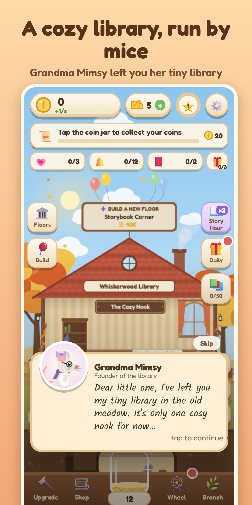
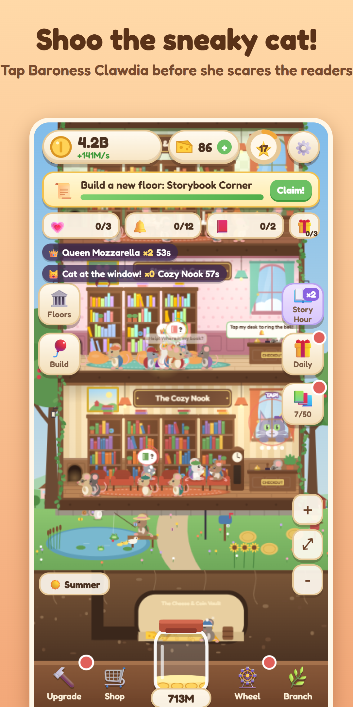
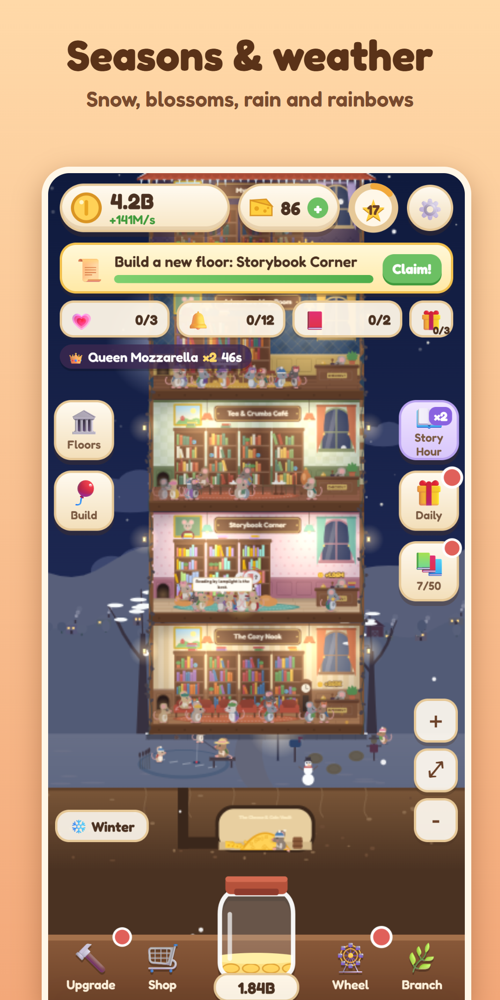
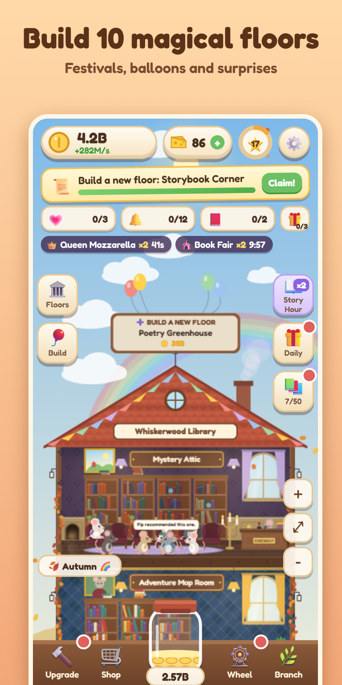

# 🐭📚 Whiskerwood Library

A cozy idle "expansion" game for mobile. You run a library for mice: every little reader pays at the checkout, the coins pile up in the **coin jar** at the bottom-centre of the screen, and you tap it to collect. Spend the coins on armchairs, bookshelves, book collections and new floors, so more mice come in and the coins arrive faster. Along the way you'll get celebrity mice, royal visits and authors holding book signings.

The art is flat vector, drawn in code (2D with a slight 3D cross-section look). The Ghibli-style waltz soundtrack is original and plays live through Web Audio. The sound effects are Kenney's CC0 packs. Ads use AdMob (native) or Google H5 Games Ads (web).

| Story | Royal visit | Shoo the cat! | Pinch to zoom |
|---|---|---|---|
|  |  |  |  |
| **Seasons & weather** | **Book Fair** | **Upgrades & books** | |
|  |  |  | |

🎵 Soundtrack previews: [`docs/soundtrack-day-preview.mp3`](docs/soundtrack-day-preview.mp3) · [`docs/soundtrack-night-preview.mp3`](docs/soundtrack-night-preview.mp3)

---

## Quick start

```bash
npm install
npm run dev          # http://localhost:5173 (also prints a LAN URL to open on your phone)
npm run build        # production build in dist/
```

In the browser, ads show as a clearly labelled **test ad** (4 s countdown), so you can try every ad placement without an ad account.

**Developer tools** (on while `devTools: true` in [src/config.js](src/config.js); a purple **DEV** tag shows on the ⚙️ button):
- a one-time gift of 5,000 golden cheese and a day of coins on the first launch;
- *Settings → 🛠️ Developer tools*: +1,000 / +10,000 cheese, +1 hour / +1 day of coins, ⏩ finish every timer (floors, wings, movers, the mole crew), and 📺 instant ads (rewarded ads pay out with no ad).

⚠️ Set `devTools: false` before building the version you upload to Google Play.

Debug in the browser console:
- `WWL.game.s.coins += 1e9` adds coins.
- `WWL.world.spawnSpecial()` brings a special guest.
- `WWL.world.events.start('cat' | 'worms' | 'lost' | 'critic' | 'fair' | 'thief')` starts an event.
- `WWL.world.seasonOverride = 3` switches to winter.
- `WWL.world.ambient.weather.left = 0` changes the weather now.
- `WWL.world.debugFestival('ramadan')` previews a festival (`null` turns it off).
- `WWL.game.s.calendar.t = 600` jumps the Mouse Calendar (0 is the start of spring; a season is 240 s by default).
- `WWL.game.s.branch = 3; WWL.world.resetForBranch()` shows another site's building.
- `WWL.game.s.deep.jobs.forEach((j) => j.end = 0)` finishes the mole crew's jobs; `WWL.ui.panToDeep()` shows the dig site.
- `WWL.ui.screens.chronicle(0)` opens Thessaly's journal; `WWL.ui.panToWing('cafe')` visits a wing.

---

## The game

### Core loop
1. **Visitor mice** pop out of the mousehole, browse a shelf, read in an armchair, then **pay at the checkout desk**.
2. Their coins drop into the **coin jar** (bottom centre). Tap it to collect. The jar has a capacity (10 min of income, upgradable), so check back often.
3. Spend the coins on each floor's upgrades:
   | Track | Effect | Notes |
   |---|---|---|
   | 📚 Book Collection (Lv 1–1000) | + income per level | **×2 income milestones** at Lv 10, 25, 50, 100, 150… The first five milestones each deliver one of the floor's album books |
   | 🪑 Seats (1–6) | more mice read at once | each seat adds a visible chair or beanbag |
   | 🗄️ Bookshelves (1–4) | attracts more visitors | the shelves visibly fill with books as the level rises, and book piles appear on top |
   | 👓 Librarian (1–20) | faster checkout | |
   | ✨ Décor ×5 | +20–40% each | rug, lamps (glow at night), fern, painting and a unique centerpiece |
4. **Build new floors.** There are 10 themed floors (Cozy Nook → Storybook Corner → Tea & Crumbs Café → Adventure Map Room → Mystery Attic → Poetry Greenhouse → Stargazer Observatory → Royal Archive → Moonlit Music Hall → Grand Atrium). Each has its own wallpaper, seats, centerpiece, genre and 5 collectible books. Construction timers show builder mice at work.
5. **Move to a bigger library** (🚚 Move): each site's building only holds so many floors. When it's full, you **buy the land** at the next site with coins, the movers get it ready (10 min → 3 h, 📺 halves the wait), and then the whole library moves in. **Nothing resets**: every floor, level, wing, book and piece of furniture comes along. You get:
   - room for more floors and more **wing plots** beside the tower,
   - a bigger branch bonus, and a few **Golden Quills** (+10% income each, forever).

   | Site | Floors | Wing plots | Land | Branch bonus |
   |---|---|---|---|---|
   | Meadow Burrow | 4 | 1 | — | ×1 |
   | Windmill Hill | 6 | 2 | 4B | ×1.25 |
   | Lighthouse Cove | 8 | 3 | 20T | ×1.5 |
   | Willow Pond | 9 | 4 | 3aa | ×2 |
   | Moonlit Castle | 10 | 4 | 400ab | ×3 |

   After the castle the tour starts again (Meadow Burrow II…) with everything open, a much bigger bonus and much pricier land ([src/data/branches.js](src/data/branches.js)). When a site is full, a sign above the roof points to the next one.
   - **Every site has its own library building and garden:** the red-tiled cottage (Meadow Burrow), a thatched farmhouse with its own windmill, barley rows and a hay cart (Windmill Hill), a blue clapboard house with a lighthouse lamp, palms, a beach and a sandcastle (Lighthouse Cove), a mossy boathouse with paper lanterns, weeping willows, a lily pond and a red bridge (Willow Pond), and a stone keep with turrets, banners, pines and a fountain courtyard (Moonlit Castle).
   - A welcome screen shows what came along and what's new, with an optional 📺 housewarming party (+cheese).

### Wings: buildings beside the library ([src/data/wings.js](src/data/wings.js), [src/world/wingArt.js](src/world/wingArt.js))
Swipe sideways (edge arrows point the way) to the plots next to the tower. Each wing is a real building with its own interior, residents, chatter and a "ready!" bubble:

| Wing | Opens at | What it does |
|---|---|---|
| ☕ The Crumb Café | Meadow Burrow | A tray of scones every 3 min (tap for coins) |
| 🎪 Whiskerwood Community Hall | Windmill Hill | Tonight's club (Book Club, Choir Night, Cheese Tasting…): ×1.5 income for 5 min, then cheese and reputation |
| 🖨️ The Inky Paw Printing Press | Lighthouse Cove | Print runs that make books for your album (📺 finish now) |
| 🦴 The Bone & Bauble Museum | Willow Pond | Shows the fossils you dig up; guided tours for coins |

Every wing level adds **+2% income to the whole library** (+10% more at Lv 10, 25, 50, 75 and 100). At **Lv 20** a wing grows a second storey and at **Lv 50** a third, each a new room with its own residents and five pieces of furniture to buy (Furniture tabs in the wing screen, each +5% income):

| Wing | Second storey (Lv 20) | Third storey (Lv 50) |
|---|---|---|
| ☕ Café | Upstairs Tea Room: chandelier, cushions, cake trolley, Chef Gustavo's portrait, palms (a waitress serves tables) | Pastry Kitchen: bread racks, cupcake tower, jam pantry, herb window, dumbwaiter (a head baker at work) |
| 🎪 Hall | Craft Room: sewing machine, pottery wheel, easel, yarn shelves, ribbon rack | Ballroom: chandelier, mirror wall, gramophone, streamers, punch table (a DJ) |
| 🖨️ Press | Bindery: guillotine, gold-leaf stamper, cover rack, sewing frame, bookmarks (a paper cutter) | Newsroom: typewriters, headline board, coffee station, pneumatic tubes, press camera (the editor) |
| 🦴 Museum | Grand Gallery: butterflies, meteorite, ancient map, shells, geode (a painter) | Planetarium: telescope, orrery, moon rock, comet, planet mobiles (an astronomer) |

**The wings are as busy as the library** ([src/world/wingSim.js](src/world/wingSim.js)). Visitors come in through the door, do their thing and leave, and garden passers-by walk to the wing doors too:
- **Café:** customers order at the counter and wait at a table until the waiter brings their tea, then tuck in. The barista works behind the counter, and upstairs there's a tea room.
- **Community Hall:** a janitor sweeps and a singer rehearses on stage. On club nights the hall fills with that club's scene:
  - **Book Club:** a reading circle.
  - **Knitting Circle:** a scarf that grows all evening.
  - **Choir Night:** robed singers and a conductor.
  - **Cheese Tasting:** a long cheese table.
  - **Chess Club:** chessboards and thinking mice.
  - **Poetry Slam:** a microphone and snapping.
  - **Dance Class:** dancing pairs under party lights.
- **Printing Press:** the printer works the press, a porter carries book stacks and collectors browse. Upstairs, binders stitch books.
- **Museum:** visitors admire the fossils, the guard naps, a painter sketches the skeleton upstairs, and school trips follow a guide with a flag.
- **Upper storeys** fill up as you furnish them: visitors head upstairs to read, craft, dance or stargaze.
- **Chatter:** every wing has its own lines and two-mouse conversations. Club nights use the club's lines.

**Wing furniture:** five pieces per wing, each +5% income and each visible in the building or outside it:
- **Café:** flower boxes, an espresso machine, a three-tier cake, a garden terrace with a parasol, fairy lights.
- **Hall:** balloons, a grand piano with a pianist, stage spotlights, a disco ball, a popcorn cart.
- **Press:** a newsstand, a type case with a type-setter, a conveyor belt, page lanterns, a delivery bicycle.
- **Museum:** placards and spotlights, a T. rex skull case, a star-map ceiling, a mammoth statue on the lawn, a gift kiosk.

**The Whiskerwood Gazette** ([src/data/gazette.js](src/data/gazette.js)): a daily paper from the press (📰 in the press screen, or tap the newsstand). Its headlines come from your own library (floors, moves, digs, scones, fossils, famous guests…), mixed with town gossip, classifieds and a horoscope. Reading it gives +2 cheese once a day.

**Wing stories:** Mayor Gruyère's never-ending opening speech, the Great Scone-Off against Madame Brioche, Baroness Clawdia joining the Knitting Circle, the Queen's upside-down portrait, Professor Marrowby and a winking Triceratops, and Pip's first choir solo.

### The Deep Stacks ([src/data/deep.js](src/data/deep.js), [src/world/deepArt.js](src/world/deepArt.js))
Building the Mystery Attic reveals a brass trapdoor under the Cheese & Coin Vault. Below it is a 9 × 7 maze of soil and bedrock:
- **Digging:** Digby Loam's mole crew digs one cell at a time, sideways or down around the bedrock. Glowing "Dig here" spots show where they can reach. Unexplored cells are dark, but halls glint through the soil. Each job costs a few minutes of income and takes 2–20 min (deeper is slower; 📺 halves it, cheese finishes it). A second crew costs 120 🧀 or ads.
- **Eight library halls** to restore in three steps each, and each looks different at every stage: dark and cobwebbed, then tidy, then lit, then full of readers. They are the Root Cellar Reading Room, the Scriptorium of Quills, the Clockwork Catalogue, the Crystal Grotto, the Sunken Galleon, the Hall of Echoes, the Lantern Stair and the Archivist's Study. Each restored hall gives **+15% income**.
- **Fossils and treasure:** a Giant Ammonite, a Triceratops Skull, a Pterodactyl and a Sabre-toothed Cat (+5% each, on show in the Museum), plus treasure chests. Decorative dinosaur skeletons, ammonites, trilobites, crystals and buried odds and ends fill the soil and the rock.
- **The Great Door:** at the bottom are eight locks, one for each hall. Behind them, Umber the dragon guards the **Mighty Tales** (×2 income forever, +50 🧀). After that, you can read Umber a bedtime story once a day.

**The story** ([src/data/story.js](src/data/story.js), [src/data/deep.js](src/data/deep.js)): every restored hall plays a chapter and adds a page to **the Chronicle**, the handwritten journal of Thessaly Vane, the last Archivist. It's a proper mystery:
- a book that writes itself, and a king who tore out the stories he didn't like;
- a brother nobody remembers;
- a captain disgraced for an act of mercy (Sneaky Rattigan finds out he's his descendant);
- a lonely dragon who had never been read to, and the truth about Grandma Mimsy's brass key.

The finale asks the player one question ("What is a book for?"). The last Chronicle page writes itself from your own library's stats.

### Mole City ([src/data/mole.js](src/data/mole.js), [src/world/moleArt.js](src/world/moleArt.js))
Up top is a city of mice; down below, once the first hall is restored, the moles move in and build a city of their own:
- **The Grand Lift:** a brass cage carrying mice, hamsters and moles from a green-and-copper **lift house on the lawn**, down through the Cheese & Coin Vault and beside the entrance to every level with a tunnel next to the shaft (6 stops, down to Umber's cavern, where the shaft is an open cage so the dragon stays in view). Riders wait by the lift house door, step in when the car arrives, and the big wheel turns in its roof window. Each stop: **+3% income**. Tap the lift or the lift house to open it.
- **Eight mole businesses**, each opened in an empty tunnel of your choice (look for the 🏪 TO LET signs). More unlock as you restore halls:

| Shop | Opens at | Fixtures |
|---|---|---|
| 🍄 Glowcap Mushroom Farm | 1 hall | glow lamps, watering cans, harvest baskets, soup pot |
| 🥧 Mrs Burrow's Pie Shop | 1 hall | stone oven, pie shelves, chalk menu, tart stand |
| 💎 Glitterdig Jewellers | 2 halls | loupe bench, ring cabinet, tiara display, sparkle lamps |
| 🍵 The Root Tea House | 3 halls | iron teapot, cushion nook, paper lanterns, bamboo screen |
| 🛁 Mudbath Spa | 4 halls | cucumber bar, towel rack, bubble jets, lily fountain |
| 🎬 Glow-worm Cinema | 5 halls | popcorn cart, velvet seats, poster wall, ticket booth |
| 🧀 The Cheese Cave | 6 halls | aging racks, tasting bell, cool stone shelf, grape juice barrel |
| 📮 Tube Post Office | 7 halls | brass tubes, sorting wall, parcel scales, stamp counter |

- **Upgrading shops, like the library:** levels 1–50 (+1% income each, +5% more at Lv 10, 25 and 50) and four fixtures (+3% each). Every shop is a lively interior: a mole shopkeeper, customers (mice, hamsters and moles) who walk in, shop, chat and leave, more customers at Lv 10 and 25, bunting, a rug and a golden sign as it grows. The fixtures show up too (the oven glows, the cinema plays a film, letters whoosh through the tubes).
- **Restored halls level up too** (Lv 1–50, +1% each): a second reader at Lv 10, a mole scholar at Lv 25 and a gold plaque at Lv 50.
- **Commuters** walk every long tunnel once the lift runs, and the lift car carries riders from stop to stop.
- **Prices are seconds of your income** (like digging), so Mole City stays a meaningful goal however rich the library gets.
- Chapters with Mrs Burrow and Hazel Pouchley (hamster travel writer) introduce the city, the first shop, the twinning of the two cities and the last shop.

### Engagement systems
- **Special guests**, about every 1–2 minutes, glowing gold with a "Visit" banner. Tap them before they leave:
  - ⭐ Celebrity mice: coin bonus, and ×2 income on that floor while present
  - ✍️ Authors: a book signing, a free book card, and ×3 on that floor
  - 👑 Royals with guards: a Royal Decree giving ×3 income
- **Pigeon Post:** a pigeon carrying a parcel flies past; tap it.
- **Fishing mouse:** tap when the float bobs to catch a fish (coins).
- **Desk bell:** tap the checkout desk to ring it for instant coins (active play).
- **Pet a mouse:** hearts, a squeak and a few coins.
- **Quests:** 15 hand-written onboarding quests with a pointing-hand tutorial, then endless generated quests that always pick a goal reachable in minutes.
- **Reputation level:** every upgrade gives XP, and each level gives golden cheese and +2% income.
- **Book album:** 50 parody books (Common → Legendary), each with a parody author, a blurb and a one-line review (tap a book in the Album or on the floor sheet). Each gives +10% on its floor, and a complete set gives ×2.
- **Parody guests:** celebrities (Taylor Swiss, Mouse Jagger, Elvis Presqueak, Lady Gouda, Oprah Whiskfrey, Gordon Ramsqueak…), royals (Queen Brie-zabeth, Napoleon Brie-naparte, Cleo-parmesan…) and authors who sign on their genre's floor (Agatha Crustie, Dr. Squeuss, Jules Vermin, William Squeakspeare, J.R.R. Tolkmouse…). Each says a catchphrase when they arrive.
- **Furniture (Shop):** 60+ pieces for seven spots on every floor (rug, lamps, painting, wall, under the window, desk and ceiling), bought once with golden cheese and **kept forever**. Common/Rare/Epic/Legendary pieces add +2/4/8/15% income. Each branch sells two local finds, and festivals bring limited specials. Place or swap them from the floor sheet (🔨 Upgrade → Furniture).
- **Floor interiors:** every floor also has its own built-in details, like the coat hooks and sampler in the Cozy Nook, the height chart and ABC bunting in Storybook Corner, the copper pans in the café, the WANTED poster and evidence board in the Mystery Attic, and the violin and sheet music in the Music Hall.
- **Daily gifts:** a 7-day streak that resets if you miss a day. **Lucky wheel:** one free spin every 6 hours.
- **Offline earnings** when you come back. **Story Hour:** ×2 income, stackable up to 4 hours.
- **Juice:** coins fly into the counter, purchase sounds climb in pitch when chained, milestone confetti, haptics, a hold-to-buy button, and a coin pile in the underground vault that grows with your wealth.
- **Day/night cycle** (12 minutes): lamps glow, fireflies, stars and moon, and a gentler nocturne arrangement of the music at night.

### Twists & surprise events ([src/world/events.js](src/world/events.js))
| Event | What happens | How to win |
|---|---|---|
| 🐱 **Baroness Clawdia** | A big cat peeks through a floor's window; readers freeze and the floor earns nothing | Tap her 4–6 times until she flees (coins + cheese) |
| 🐛 **Bookworms** | Worms nibble a floor's shelves (−40% income) | Squish them all (coins each + bonus cheese) |
| 📕 **Lost book** | A glowing book is hidden somewhere in the tower | Scroll and zoom to find it (album book + cheese) |
| 🦹 **Sneaky Rattigan** | A masked rat runs along the bottom bar toward your coin jar | Catch him for a bonus; if he gets there, he steals 20% of the jar |
| 📝 **Monsieur Fromage** | A critic reviews a floor from 1 to 5 stars and says what's missing | 4–5★ gives ×2 income for 5 min (📺 cheese platter adds +1★) |
| 🎪 **Book Fair** | Bunting on the roof, confetti, all income ×2 and extra visitors | 📺 extend by 3 min |
| ❓ **Book requests** | A reader shows a thought bubble with the book they want | Tap within 11 s for a tip and hearts |
| 🌧️ **Weather** | Rainy days (×1.5) and snow days (×1.3) bring more readers, and a rainbow follows the rain | |

### Festivals & holidays ([src/data/festivals.js](src/data/festivals.js), [src/world/festive.js](src/world/festive.js))
Festivals decorate the whole library: lights along the roof, something festive in every window, a garden piece by the path and a little sky mood. There's festive chatter, limited Shop specials and a daily festival gift (tap the season chip, 📺 ×2).

The festivals are:
- Ramadan (lanterns, a crescent moon and warm evenings) and Eid
- Lunar New Year (red lanterns, firecrackers and fireworks)
- a Spring Egg Hunt (painted eggs and a basket)
- Diwali (diyas, a marigold garland, a rangoli on the path and fireworks)
- Hanukkah (a menorah that lights one more candle as the festival goes on, and a dreidel)
- Christmas, New Year with fireworks, and Halloween
- Book Lovers' Day, Book Week and the library's birthday
- the Summer Reading Festival and the Harvest Festival

**Two calendars:**
- Real holidays appear on their real dates. Ramadan, Eid, Lunar New Year, Diwali and Hanukkah use date tables for 2025–2031, and Easter is calculated.
- Every festival also comes round once in each **Mouse Year** (`MOUSE_FESTIVALS`), so players meet them all within a session:

| Season | Festivals |
|---|---|
| Spring | Lunar New Year, Egg Hunt, Ramadan, Eid |
| Summer | Book Week, Summer Reading |
| Autumn | Harvest, Diwali, Halloween |
| Winter | Hanukkah, Christmas, New Year |

The month-long Summer and Harvest festivals only use the Mouse Calendar, so they never hide the others. Festivals never freeze the season, though Christmas and New Year add a little snow.

### Seasons & life ([src/world/ambient.js](src/world/ambient.js))
- **Mouse Calendar** ([src/core/calendar.js](src/core/calendar.js)):
  - The library keeps its own years. By default a season lasts 4 minutes of play, so a **Mouse Year is 16 minutes**; *Settings → Season speed* offers Relaxed (32 min) or Speedy (8 min).
  - Colours blend into the next season in its last seconds, the mice cheer when it changes, and each **Mouse New Year** brings a fanfare and 2 golden cheese.
  - The season chip shows the season, the year and a progress bar; tap it to see when the next season comes.
  - The calendar also advances up to one season while you're away.
- **Seasons:** spring blossom petals and tulips, summer sunflowers and butterflies, autumn leaves and pumpkins, winter snow with a frozen pond, a skating mouse, a snowman, and snow and icicles on the roof.
- **Books** have real bindings. Album covers get a cloth or paper pattern, a gold genre emblem, a title plate or foil lettering, spine bands, page edges, and rarity tooling up to a shimmering gilt Legendary. Shelf spines get raised bands, labels, leather caps or tooled dots.
- **Around the library:** passers-by walk to the door (with umbrellas in the rain), a postmouse cycles past, frogs hop between lily pads, ducks swim, a snail crawls by, and two big trees change with the seasons.
- **Sky:** small flocks of birds, shooting stars at night (tap one for a wish, +3 cheese) and hot-air balloons (tap for a gift). It's kept calm: only one flying visitor at a time, and "+coins" pop-ups are merged to one per floor every couple of seconds.
- **Textures** ([src/world/textures.js](src/world/textures.js)): grass blades and mown stripes on the lawn, soil crumbs and pebbles, bedrock facets, bark on the trunks, sunlit leaf clusters in the canopies, plaster on the walls, bricks and shingles on the wings, and soft sheen, shading and a fur tuft on every mouse. The UI panels and buttons have a paper grain, and the bottom bar has wood grain.
- **Background:** a village with glowing windows and chimney smoke, sheep on the hills, and ivy and lanterns growing up the library as it rises.

### Story, chatter & quick goals
- **Story chapters** ([src/data/story.js](src/data/story.js)) with drawn character portraits: Grandma Mimsy, Pip the apprentice, Mayor Gruyère, Chef Gustavo, Queen Mozzarella, Monsieur Fromage, Sneaky Rattigan and the villain, Baroness Clawdia. The arc ends when the Golden Crumb glows and Clawdia admits she only wanted someone to read to her.
- **Chatter** ([src/world/chatter.js](src/world/chatter.js)): speech bubbles that react to each floor's genre, the weather, season, time of day and events, plus tips from the librarian. Readers gossip about parody books, spoil endings, leave strange reviews and terrible recommendations, hold little two-mouse conversations, react when you upgrade or redecorate their floor, and very occasionally notice the giant finger in the sky.
- **Quick tasks** ([src/data/tasks.js](src/data/tasks.js)): three short goals are always on screen (pet 3 mice, catch a fish, squish 4 worms…). Finish all three to open a reward chest and get three new ones.
- **Zoom:** pinch, ctrl+scroll or the ＋/－/⤢ buttons (0.5×–2.6×). Drag in any direction when zoomed in.

### Smooth play (performance)
The world is big (ten floors, four wings with three storeys, a 63-cell maze and Mole City), so the renderer does as little work per frame as it can:
- **Everything static is painted once and cached:** each floor, wing and maze cell, the lawn and garden, and the soil band with the vault. The cache is redrawn only when something changes (an upgrade, furniture, a season) and is kept while pinching, so zooming never stutters. Maze cells are kept by a pixel budget, least recently used first.
- **Only what's on screen is drawn:** floors, wings, cells, ivy, lanterns and the people inside cells whose floor is visible. Nothing in the sky is drawn while you're underground.
- **Cheaper details far away:** when zoomed out, mice, moles and hamsters are drawn with a third of the shapes. Glows are pre-rendered sprites instead of live gradients.
- **Steady frame rate:** capped at 60 fps (120 Hz phones don't burn battery on double work), and a bad frame can never freeze the game.
- **Adaptive resolution:** ⚙️ Settings → 🖥️ Graphics: *Auto* (default) measures real frame times and lowers or raises the render resolution to hold a smooth frame rate. *Beautiful*, *Balanced* and *Smooth* pin a level for players who prefer one. Weaker devices start at a lower level.
- A developer profiler is built in: run `WWL.world.prof = {}` in the console, then read `WWL.world.prof` for milliseconds per frame by layer.

### Economy balancing
Numbers were tuned with a bot that plays the game ([scripts/simulate.mjs](scripts/simulate.mjs)):

```
npm run simulate                 # pacing report (floors, moves, wings, Deep Stacks)
node scripts/tune.mjs            # re-fit floor unlock costs to target times
node scripts/smoke.mjs           # plays 4h of quests, moves, wings, digging and Mole City headlessly
node scripts/molecity.mjs        # logic checks for the lift, shops, hall levels, quests and saves
```
Pacing for someone playing non-stop, skipping half of every timer (sessions plus offline time stretch this over several days):

| Milestone | Time |
|---|---|
| 4 floors, the café, first move | ~15 min |
| Deep Stacks open, Community Hall | ~15–30 min |
| First hall restored | ~1 h |
| Lighthouse Cove, floors 7–8, the printing press | ~1.5–2 h |
| Willow Pond, floor 9, the museum | ~3–4 h |
| Moonlit Castle, the Grand Atrium | ~6–7 h |
| The Mighty Tales | ~11–12 h |
| Mole City fully grown (8 shops at Lv 50 with fixtures, 6 lift stops, halls Lv 50) | several days (prices scale with income) |

Every economy number lives in [src/data/rooms.js](src/data/rooms.js), [src/data/branches.js](src/data/branches.js), [src/data/wings.js](src/data/wings.js), [src/data/deep.js](src/data/deep.js), [src/data/mole.js](src/data/mole.js) and [src/core/economy.js](src/core/economy.js).

---

## Monetization (ads)

Every rewarded ad is **opt-in** (the 📺 purple buttons). This keeps you within AdMob policy and gets the best eCPMs. The placements tie into moments of excitement and anticipation:

| Placement | When it appears | Reward |
|---|---|---|
| `jar_x2` | bubble next to a well-filled coin jar (2.5 min cooldown) | collect ×2 |
| `offline_x3` | "Welcome back!" screen | offline coins ×3 |
| `celeb_x3` | after greeting a celebrity | celebrity bonus ×3 |
| `royal_decree` | after greeting royalty | ×3 income for 10 min + 10 🧀 (free option: 1 min) |
| `author_book` | after a book signing | a second signed book |
| `parcel_gold` | pigeon parcel | 5 min of coins + cheese/book chance (free option: 45 s) |
| `build_speedup` | construction screen | halves the remaining build time (repeatable) |
| `free_upgrade` | an upgrade that's *almost* affordable (3 min cooldown) | the upgrade for free |
| `story_hour` | rail button / shop | ×2 income for 30 min (stacks to 4h) |
| `wheel_spin` | lucky wheel | bonus spin (6/day) |
| `daily_x2` | daily gift | double today's gift |
| `shop_cheese` | shop | +5 golden cheese (5/day) |
| `quest_x2` | 📺×2 chip on a finished quest (from quest 5, 10/day) | double the quest reward |
| `task_chest_x2` | task chest (6/day) | a second helping |
| `gift_box` | a mystery gift on the doorstep every 7–12 min (from quest 7, 6/day); peeking is free | 15 min of coins + cheese, maybe furniture or a book |
| `second_chance_thief` / `second_chance_cat` | after Rattigan gets away / Clawdia scares the readers (4/day each) | get the stolen coins back / free cocoa brings the readers back |
| `shop_deal` | the Shop's daily furniture deal (1/day) | half price today |
| `opening_party` | grand opening of a new floor | ×3 income on that floor for 5 min |
| `housewarming` | welcome screen after moving | + golden cheese |
| `festival_gift` | festival gift (season chip or Shop) | double today's gift |
| `move_speedup` | the movers' screen | halves the wait for the new site |
| `wing_speedup` | a wing under construction | halves the build time |
| `dig_speedup` | a mole crew job | halves the remaining time |
| `press_rush` | a print run in progress | finishes it now |
| `shop_adbuy` | 📺 x/N under every cheese price in the Shop (and the second mole crew) | the item, after N ads (about 6 🧀 per ad; progress is kept; 30/day) |

**Interstitials** only appear at natural breaks (after a floor's grand opening), never in the first 3 minutes of a session, never within 4 minutes of another ad, and only after the 4th floor. Tune this in [src/config.js](src/config.js). The "No Break Ads" in-app purchase removes them.

### Going live with AdMob
1. Create the app and ad units (rewarded + interstitial) in AdMob.
2. Put your IDs in [src/config.js](src/config.js), set `testing: false`, and replace the App ID in `android/app/src/main/AndroidManifest.xml` (`com.google.android.gms.ads.APPLICATION_ID`).
3. GDPR consent (Google UMP) is requested automatically on startup, and "Ad privacy options" appears in Settings.
4. ⚠️ If you market the game to **children** (cute mice attract them), you must follow Google Play's *Families* policy: use only certified ad networks and set child-directed treatment when initializing AdMob. Otherwise set your store age rating to 13+.

### Web / H5 build
Set `CONFIG.ads.h5.client` to your AdSense publisher ID to use Google's H5 Games Ads (`adBreak`) API for web releases.

### In-app purchases (optional)
[src/iap.js](src/iap.js) defines *No Break Ads*, *Pouch of Cheese* and *Barrel of Cheese*. Implement `window.WWL_IAP.purchase(id) → Promise<boolean>` with RevenueCat (`@revenuecat/purchases-capacitor`) or `cordova-plugin-purchase`, and the rewards are granted automatically.

---

## Building the mobile apps (Capacitor)

**Android** (the project is already generated in `android/`).

You need **Java 21** (Capacitor 8's plugins compile with it) and the Android SDK (it comes with Android Studio). The build launcher, [scripts/gradle.mjs](scripts/gradle.mjs), finds both on its own:
- **Java:** it looks in `D:\Java`, the usual install folders, Android Studio's bundled Java, or the `JAVA21_HOME` environment variable.
- **Android SDK:** it writes `android/local.properties` for you.

Every command below builds the game, copies it into the Android project and runs Gradle, from Windows `cmd`, PowerShell, macOS or Linux. Copy only the command, not the explanation next to it.

| Command | You get | For |
|---|---|---|
| `npm run android:apk` | `android/app/build/outputs/apk/debug/app-debug.apk` | Testing: install it on any phone (no signing needed) |
| `npm run android:apk:release` | `android/app/build/outputs/apk/release/app-release.apk` | A signed APK to share outside Google Play (needs your upload key, see below) |
| `npm run android:release` | `android/app/build/outputs/bundle/release/app-release.aab` | Uploading to Google Play (needs your upload key) |
| `npm run android` | Opens Android Studio | Running on an emulator or a plugged-in phone with Run ▶ |

To install the test APK, copy it to your phone and open it (allow "install unknown apps" when asked). Or, with the phone plugged in and USB debugging on, run `adb install -r android/app/build/outputs/apk/debug/app-debug.apk`.
Native features on Android:
- The hardware **back button** closes dialogs, then the sheet, then asks before leaving.
- The status bar is hidden for immersive play, with edge-to-edge safe areas.
- **Local reminders** (jar full, grand opening ready, daily gift, "the mice miss you") are scheduled when the app goes to the background. Permission is requested after the 2nd floor, never at launch.
- An **in-app review** prompt appears once after the 5th floor and once after the first new branch.
- **Low-power mode** kicks in automatically on slow phones.

---

## 🚀 Publishing on Google Play (step by step)

1. **Turn off the developer tools:** set `devTools: false` in [src/config.js](src/config.js) (the DEV tag on ⚙️ disappears).
2. **Create your upload key.** Do this once, and keep the file and passwords safe and backed up (if you lose them, you can't update the app). `keytool` comes with Java: use the full path if your terminal can't find it (for example `D:\Java\jdk-21.0.12.1+1\bin\keytool`).
   ```bash
   keytool -genkeypair -v -keystore android/whiskerwood-upload.jks -alias upload -keyalg RSA -keysize 2048 -validity 10000
   ```
   Then create `android/keystore.properties` (it's git-ignored):
   ```
   storeFile=../whiskerwood-upload.jks
   storePassword=YOUR_PASSWORD
   keyAlias=upload
   keyPassword=YOUR_PASSWORD
   ```
3. **Set your real IDs:**
   - AdMob App ID in `android/app/src/main/AndroidManifest.xml`
   - Ad unit IDs in `src/config.js`, with `ads.admob.testing = false`
   - `privacyUrl` in `src/config.js` (your website's `/privacy` page)
4. **Put the website online** (see [Website](#-website-vercel) below). It hosts the privacy policy, the terms, `app-ads.txt` and a playable web version.
5. **Bump the version.** Increase `versionCode` (for example 2 → 3) and `versionName` in `android/app/build.gradle` for every upload.
6. **Build the signed bundle:**
   ```bash
   npm run android:release
   ```
   It's written to `android/app/build/outputs/bundle/release/app-release.aab`. You can also use Android Studio: *Build → Generate Signed Bundle / APK → Android App Bundle*.
7. **Play Console:**
   - Create the app → **Internal testing** → upload the `.aab` → test on your phone.
   - Complete **App content** (ads, target audience, content rating, data safety) using the answers in [docs/store-listing.md](docs/store-listing.md).
   - Add the store listing text and graphics from `docs/store/` (regenerate them with `npm run store-assets`).
   - Promote to **Closed testing**. New personal developer accounts must run a closed test with at least 12 testers for 14 days before production access.
   - Then go to **Production**.
8. **AdMob:** add the app's Play Store link in AdMob, set up the GDPR message under *Privacy & messaging*, and wait for AdMob to review the app before real ads serve. Put your website address in the Play listing's **Website** field, so AdMob can find your `app-ads.txt`.

**iOS** (requires a Mac with Xcode):
```bash
npm install
npx cap add ios
npm run ios
```
Add to `ios/App/App/Info.plist`: `GADApplicationIdentifier` (your iOS AdMob App ID), the `SKAdNetworkItems` list from Google's docs, and `NSUserTrackingUsageDescription` ("Your data will be used to show you relevant ads."). The launcher icons and splash screens were generated from `assets/` with `npx @capacitor/assets generate`.

---

## 🌐 Website (Vercel)

[site/](site/) is the game's website. [scripts/build-site.mjs](scripts/build-site.mjs) builds it into `site-dist/`, and [vercel.json](vercel.json) tells Vercel how to build and serve it:

| Page | What it is |
|---|---|
| `/` | The landing page: trailers, features, seasons and festivals, the story, screenshots and FAQ |
| `/play/` | The game itself, playable in a browser. It has no ads: rewarded "ads" become a thank-you bonus, see [src/ads/ads.js](src/ads/ads.js) |
| `/privacy` | The privacy policy (for the Play Console and the in-game link) |
| `/terms` | Terms of use |
| `/app-ads.txt` | AdMob's authorised-sellers file |
| `robots.txt`, `sitemap.xml`, 404 page | For search engines, and for broken links |

**1. Fill in your details** in [site/site.config.json](site/site.config.json):
- `developer`: your name or studio.
- `supportEmail`: the same address you give Google Play.
- `siteUrl`: your Vercel address.
- `playStoreLive`: set it to `true` once the game is published. The "Coming soon" button then becomes "Get it on Google Play".
- `admobPublisherId`: optional, `pub-…`. Without it, the id is taken from your real AdMob app id in `src/config.js`.

Check the result locally:
```bash
npm run build:site
npx serve site-dist
```

**2. Deploy.** Either:
- Push the repo to GitHub, then on [vercel.com](https://vercel.com) choose **Add New → Project → Import** this repository and click **Deploy**. `vercel.json` sets the build command and output folder, so leave the other settings as they are. Every later push redeploys.
- Or, without GitHub: run `npx vercel` in the project folder (log in once), then `npx vercel --prod`.

**3. Point everything at it.** Say your site is `https://whiskerwood-library.vercel.app`:
- In `site/site.config.json`, set `siteUrl`. In `src/config.js`, set `privacyUrl` to `https://…/privacy`. Both are already set to that address, so change them if yours is different.
- In the Play Console: *App content → Privacy policy* is `https://…/privacy`, and *Store listing → Website* is `https://…`.
- In AdMob: *Apps → your app → app-ads.txt* should find your file within a day or so. It needs your real publisher id, so redeploy after you add it.

**Refreshing the pictures and trailers:** re-render the ads and their clean stills (see [ad/README.md](ad/README.md)), then run `python site/make-media.py`. The images and trailers in `site/img` and `site/media` are committed, so Vercel doesn't need Python or ffmpeg.

---

## Project structure

```
src/
  main.js              boot, game loop, autosave, offline detection
  native.js            Android back button, reminders, immersive mode, review prompt
  config.js            ad IDs, ad pacing, privacy URL, IAP switch
  core/                game state & rules (no DOM): economy, game, save, format
  data/                floors, books, visitors, quests, tasks, story, daily/wheel/shop tables, sites (branches),
                       wings, the Deep Stacks maze and the Chronicle, Mole City (mole.js)
  world/               canvas renderer: camera + pinch zoom, mouse/cat drawing, room art cache (+ furnish.js),
                       branch buildings (buildings.js) and gardens (landscape.js), festival decor (festive.js),
                       scenery, seasons & weather (ambient.js), events.js, chatter.js, visitor AI, particles,
                       wings (wingArt.js, wingSim.js), the maze (deepArt.js), Mole City + the lift (moleArt.js),
                       creatures (moles, hamsters, Umber, fossils), glow sprites, adaptive quality (quality.js),
                       sprites.js: characters and scenery drawn once into cached pictures (a sprite atlas)
                       and stamped every frame, which is what keeps phones smooth
  ui/                  HUD, quick tasks, upgrade sheet, dialogs, story overlay + portraits, tutorial pointer,
                       the storybook prologue (prologue.js), features appearing as you grow (reveal.js)
  audio/               Web Audio setup, the songbook (music.js + songs.js), sound effects (sfx.js),
                       the characters' babbling voices (voices.js)
  ads/ads.js           AdMob / H5 / mock ad providers
public/audio/          Kenney CC0 sound effects (mp3); prologue/ holds the storybook narration
scripts/               balance simulator, tuner, logic smoke tests, store-asset generator,
                       narrate-prologue.py (re-voices the prologue with Kokoro after a text change),
                       build-site.mjs (the website) and gradle.mjs (Android builds on any OS)
site/                  the website: pages, styles, images and trailers (see "Website" above)
ad/                    the two video ads, rendered from the real game (see ad/README.md)
docs/                  privacy policy, store listing + Play Console answers, store graphics, soundtrack previews
android/               Capacitor Android project (AdMob App ID, signing config, notification icons)
```

## Credits & licences
- **Music:** six original pieces composed for this game and synthesized live (day, night, underground, festivals, rain, winter); no external files. You can drop in your own tracks via `CONFIG.musicFiles`.
- **Storyteller voice:** the prologue narration is made with [Kokoro](https://github.com/hexgrad/kokoro) (Apache 2.0) via `scripts/narrate-prologue.py`.
- **Sound effects:** [Kenney.nl](https://kenney.nl) *RPG Audio* and *Interface Sounds*, CC0 1.0 (see `public/audio/KENNEY_LICENSE.txt`).
- **Fonts:** Fredoka and Kalam, SIL Open Font License, via Fontsource.
- **Art:** every mouse, floor and prop is drawn procedurally in `src/world/`.
